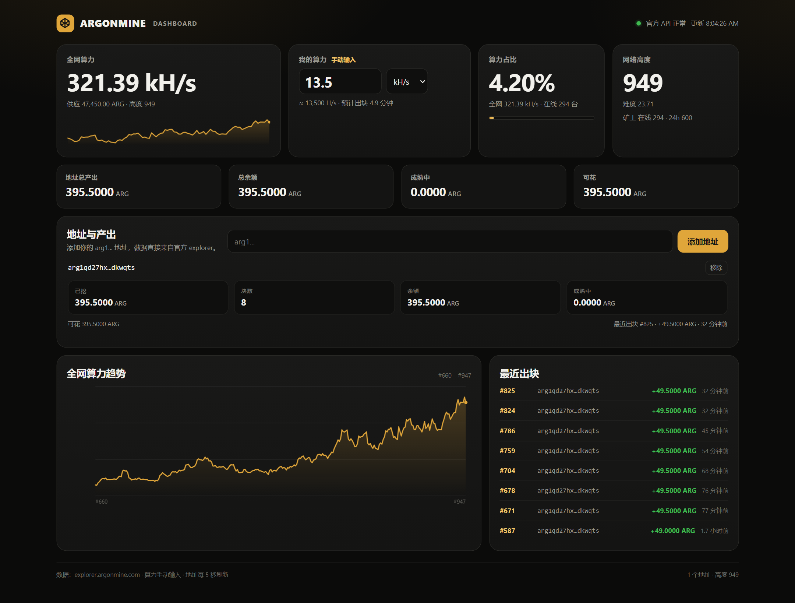

# Argonmine GPU Miner

**Unofficial native CUDA miner for [Argonmine](https://argonmine.com/) (ARG)** — Windows, solo mining, no pool, no account, no private keys.

[中文说明](README.zh-CN.md) · [Consensus spec](https://docs.argonmine.com/spec) · [Mining protocol](https://docs.argonmine.com/mining) · [Explorer](https://explorer.argonmine.com)



*Dashboard with a public sample address and a manually entered 13.5 kH/s. The dashboard does not need the miner to be running.*

> **Status: beta.** The proof-of-work path is verified against real mainnet block 652. Block discovery is probabilistic; run `--selftest` and `--benchmark` before mining.
>
> This is a community project. It is not affiliated with, endorsed by, or maintained by the Argonmine project. The Argonmine name, logo and protocol belong to their respective owners. It is a user-run miner: no telemetry, no background service, no hidden mining.

---

## What it is

Argonmine is a proof-of-work chain whose mining algorithm is **Argon2id** with a deliberately memory-hard 8 MiB working set. Browser mining works, but a native CUDA implementation is much faster.

This project is a complete native miner:

- runs the exact consensus Argon2id parameters on the GPU
- speaks the public work protocol (`GET /api/work`, `POST /api/work/submit`)
- verifies that a template really pays your address before hashing it
- pays block rewards directly to your `arg1...` address in the coinbase
- includes a local web dashboard for network stats, manual hashrate, share and per-address production

It is **solo mining**. There is no pool, no share accounting and no custodian. Whoever finds the block gets the reward in that block.

## Features

- **Native CUDA Argon2id** — `t=1, m=8192 KiB, p=1`, 32-byte output, salt `Argonmine/pow/v1`
- **Solo work protocol** — fetches its own block template and submits nonces
- **Template verification** — coinbase payout, treasury output, transaction/witness merkle roots, header bits vs target
- **No keys** — only your public payout address is needed; the miner never asks for a recovery phrase
- **Retry logic** — work fetch retries; a found solution is resubmitted with backoff on network errors, 429/503/busy
- **Watchdog-friendly** — exits after repeated GPU errors so a supervisor can restart the CUDA context
- **Windows sleep guard** — keeps the system awake while mining; display may turn off
- **Multi-GPU / multi-rig** — run one process per GPU; several machines can mine to the same address
- **Local dashboard** — manual hashrate, network share, multiple addresses and their on-chain output
- **Real-block self-test** — reproduces the exact PoW hash and target check of mainnet block 652

## Performance

Measured on the development machine:

| GPU | VRAM | `--batch` | Hashrate | Notes |
|---|---:|---:|---:|---|
| RTX 3080 Laptop | 16 GB | 1024 | **~13.5 kH/s** | measured, 8 GiB VRAM |
| RTX 5070 | 12 GB | 1024 / 1280 | ~20 kH/s expected | community target, not yet benchmarked here |
| Browser reference | — | — | ~10–25 H/s/core | official docs |

Argon2id is memory-bandwidth-bound. Real numbers depend on the card, power limit, cooling and driver. A laptop that reaches ~89 °C will thermally throttle and lose hashrate.

VRAM is `batch × 8 MiB`:

| `--batch` | VRAM | 16 GB card |
|---:|---:|---:|
| 512 | 4 GiB | 25% |
| 768 | 6 GiB | 37.5% |
| 1024 | 8 GiB | 50% |
| 1280 | 10 GiB | 62.5% |
| 1536 | 12 GiB | 75% |

Leave 3–4 GiB for Windows and the display. On a 12 GB card, `1024` is the safe default; `1280` only if the card is headless.

## Requirements

### Prebuilt binary

- Windows 10/11 x64
- NVIDIA GPU and a recent NVIDIA driver
- **No CUDA Toolkit and no VC++ Redistributable required** — the release exe is a single static binary (it only imports `WINHTTP.dll` and `KERNEL32.dll`)

### Build from source

- Visual Studio 2022 with **Desktop development with C++**
- CUDA Toolkit **11.7+**
- For RTX 50 series (`sm_120`): **CUDA Toolkit 12.8+**
- Python 3 only if you want the local dashboard proxy; `dashboard.html` can also run directly

## Quick start (prebuilt)

1. Get your payout address from <https://app.argonmine.com/> → **Receive**. It starts with `arg1`. Back up the 24 words offline.
2. Download the latest release zip from the **Releases** page and extract it.
3. Double-click `argonmine-gpu.exe`.
4. Enter your address, then the batch (press Enter for `1024` = 8 GiB).
5. The setting is saved to `argonmine-gpu.cfg`; next time just double-click.

Or use the setup script:

```bat
setup.bat
```

For 24/7 operation:

```bat
watchdog.bat
```

`watchdog.bat` restarts the miner 5 seconds after a crash. Stop it with:

```bat
stop.bat
```

Run a self-test first:

```bat
argonmine-gpu.exe --selftest --batch 512
argonmine-gpu.exe --benchmark 10 --batch 1024
```

`--benchmark` does not contact the network and never submits.

## Build from source

```bat
git clone https://github.com/<your-name>/argonmine-gpu-miner.git
cd argonmine-gpu-miner
build.bat
```

`build.bat` auto-detects the first NVIDIA GPU's compute capability:

- RTX 30 → `sm_86`
- RTX 40 → `sm_89`
- RTX 50 → `sm_120` (requires CUDA 12.8+)
- GTX 16 / RTX 20 → `sm_75`

Then:

```bat
argonmine-gpu.exe --selftest --batch 512
argonmine-gpu.exe --address arg1... --batch 1024
```

## Usage

```text
argonmine-gpu.exe --address arg1... [options]
```

| Option | Description |
|---|---|
| `--address ADDR` | payout address (`arg1...`) |
| `--ref ADDR` | optional referrer address |
| `--url URL` | work server, default `https://explorer.argonmine.com` |
| `--batch N` | hashes in flight; each uses 8 MiB VRAM; default 1024 |
| `--device N` | CUDA device index (default 0) |
| `--duration N` | stop after N seconds |
| `--dry-run` | fetch and mine, never submit |
| `--test-submit` | submit a dummy nonce to test the submit path |
| `--selftest` | CPU/GPU cross-check + mainnet block 652 vector |
| `--benchmark [S]` | local benchmark for S seconds (default 10) |
| `--no-verify` | skip template verification (not recommended) |
| `--help` | show help |

### Multiple GPUs / multiple rigs

One process per physical GPU:

```bat
start argonmine-gpu.exe --address arg1... --device 0 --batch 1024
start argonmine-gpu.exe --address arg1... --device 1 --batch 1024
```

Several machines can mine to the same address. Each one fetches its own template and submits its own blocks; all rewards pay the same wallet. There is no share accounting. The official work server keeps **8 open jobs per payout address**, so about **6–7 concurrent rigs per address** is the practical limit; more can evict each other's jobs and produce `stale` submissions. For more rigs, run your own node + explorer work server.

## Dashboard

The dashboard is a local web page: manual hashrate plus official explorer data. It does not read the miner or need it to be running.

```bat
dashboard.bat
```

Open <http://127.0.0.1:8787/>.

- Enter your hashrate manually (`H/s`, `kH/s`, `MH/s`)
- See network hashrate, your share, expected time to a block
- Add multiple `arg1...` addresses
- See each address's balance, mined total, blocks, maturing, spendable and recent blocks
- Network hashrate chart, height, difficulty and online miner count

`dashboard.bat` starts a small Python 3 proxy bound to `127.0.0.1`; it forwards only the explorer API endpoints the page needs. If Python is unavailable, `dashboard.html` can be opened directly, provided the browser can reach `explorer.argonmine.com`.

For LAN access (phone/another PC on the same network):

```bat
python dashboard.py --host 0.0.0.0 --port 8787
```

The dashboard only needs public addresses. **Never enter a private key or recovery phrase anywhere.**

## How it works

### Proof of work

The miner hashes the 120-byte block header:

```text
version        u32
prev_hash      32 B
tx_root        32 B
witness_root   32 B
time           u64
bits           u32
nonce          u64
```

with:

```text
Argon2id(password = header, salt = "Argonmine/pow/v1",
         t = 1, m = 8192 KiB, p = 1, outlen = 32)
```

The 32-byte result is read as a **little-endian** 256-bit integer and compared with the **big-endian** target from the header's `bits`.

### Work protocol

```text
GET  /api/work?address=<payout>[&ref=<referrer>]
POST /api/work/submit  {"job_id":"…","nonce":123,"address":"arg1…"}
```

The work server builds the coinbase and the rest of the block; the miner only searches nonces and submits a solution. The server checks the PoW and hands the block to its node.

### Verification

Before hashing a template, the miner checks:

- `bits` matches the target
- the coinbase pays **your** address
- from block 300, the coinbase pays at least 1% of the subsidy to the treasury
- the coinbase's txid/wtxid fold to the header's transaction and witness roots through the supplied merkle branches
- the accepted referrer (if any) is paid

If any check fails, it refuses the job. `--no-verify` exists only for debugging.

### Self-test

```text
argonmine-gpu.exe --selftest
```

It compares the GPU with the CPU reference on random headers and reproduces the exact Argon2id hash of mainnet block 652, including the target check. This validates the header serialization, nonce endianness, Argon2 parameters and big-endian target comparison against a real block.

## Known issues & limitations

- **Official explorer double-deducts the treasury (server-side bug, Oct 2026).** The node's `coinbasevalue` already excludes the 1% treasury, and the explorer subtracts it again. The template total is 49.5 ARG instead of 50, so with no referrer the miner receives 49 ARG and 0.5 ARG is burned. The miner prints a warning and keeps mining. Node-mined blocks show 50 ARG, which confirms the explorer is the source. This may be fixed server-side at any time.
- **Thermal throttling.** A laptop can hit ~89 °C and drop from its boost clock. Improve cooling or lower `--batch`.
- **Official work server dependency.** The miner can only work while a work server is reachable. For maximum uptime, run your own node + explorer and point `--url` at it.
- **Solo variance.** A 13 kH/s miner on a 300 kH/s network has ~4% share; a block can take a long time, and blocks are random.
- **No pool protocol.** This project is a solo miner, not a share-based pool.

## Troubleshooting

| Problem | Fix |
|---|---|
| `no kernel image is available` on RTX 50 | Install CUDA 12.8+ and rebuild with `sm_120`; the prebuilt contains PTX, but a native build is faster/safer |
| `cudaMalloc failed` | Lower `--batch`; close other GPU apps |
| `Refusing job …` | The work server's template failed verification; update the miner, or use `--no-verify` only to diagnose |
| `work: HTTP 503` | Explorer is unhealthy; it retries automatically |
| Windows SmartScreen “unknown publisher” | The binary is unsigned; use “More info → Run anyway”, or build from source |
| Low hashrate | Check temperature/power limit, `--batch`, and whether another process shares the GPU |

## Repository layout

```text
src/
  main.cpp          CLI, work loop, verification, status file
  gpu_miner.cu/.h   CUDA Argon2id kernels and host launcher
  argon2_cpu.*      CPU reference Argon2id
  blake2b.h         Blake2b / long hash
  sha256.h          SHA-256 and tagged hashes
  bech32.*          address decode/encode
  work.*            work protocol parsing, coinbase/merkle checks
  http.*            WinHTTP client
  json.h            small JSON helpers
tests/
  gpu_selftest.cu   GPU vs CPU test harness
  selftest.cpp      CPU Argon2 test
res/
  app.rc, argonmine.ico
dashboard.html      local dashboard (single file)
dashboard.py        optional local API proxy
dashboard.bat       dashboard launcher
build.bat           Windows build
setup.bat           address + batch setup
watchdog.bat        auto-restart supervisor
stop.bat            stop the watchdog/miner
docs/dashboard.png  screenshot
LICENSE, NOTICE, SECURITY.md, PUBLISHING.md
```

## Publishing this project on GitHub

This repository is source-only: binaries are intentionally ignored and should go to **Releases**, not commits.

```bat
git init
git add .
git commit -m "Initial commit: Argonmine GPU miner"
git branch -M main
git remote add origin https://github.com/<your-name>/argonmine-gpu-miner.git
git push -u origin main
```

Then create a GitHub Release and upload:

```text
dist\argonmine-gpu-1.0.1-win64.zip
```

Suggested repository description:

> Unofficial native CUDA GPU miner for Argonmine (ARG), with template verification and a local web dashboard.

Suggested topics: `argonmine`, `arg`, `gpu-miner`, `cuda`, `argon2id`, `windows`, `solo-mining`.

Do not commit `argonmine-gpu.cfg`, `miner-status.json`, `dist/`, or any `.exe`/`.zip`; `.gitignore` already excludes them.

## Contributing

Issues and pull requests are welcome. Please:

- run `argonmine-gpu.exe --selftest` before submitting changes to the GPU or consensus code
- keep the template verification intact; changes that silently remove checks will not be accepted
- do not add hidden mining, telemetry, or code that runs without the user's knowledge
- test on a real GPU if possible and include the model, driver, CUDA version and hashrate

## License and attribution

This project is released under the **MIT License** — see [LICENSE](LICENSE).

Third-party attributions are in [NOTICE](NOTICE):

- Argonmine protocol/spec and brand assets: the [Argonmine project](https://github.com/argonchain-source/argonchain), MIT
- Argon2id algorithm: RFC 9106 / PHC winner; the CPU reference is derived from the public Argon2 reference and `golang.org/x/crypto/argon2`, BSD-3-Clause
- NVIDIA and CUDA are trademarks of NVIDIA Corporation

This is an unofficial project. It is not affiliated with or endorsed by the Argonmine project or NVIDIA.

## Disclaimer

Mining consumes electricity and puts sustained load on your GPU. Verify temperatures, power delivery and cooling. Cryptocurrency rules differ by jurisdiction; comply with your local laws. The software is provided **as is**, without warranty; use it at your own risk. Never share your 24-word recovery phrase with anyone, and never enter it into this miner or the dashboard.
