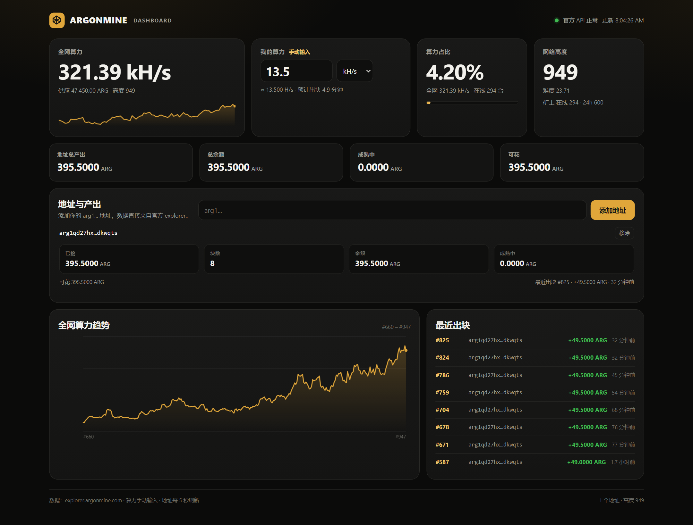

# Argonmine GPU 矿机

[English](README.md) · [共识规范](https://docs.argonmine.com/spec) · [挖矿协议](https://docs.argonmine.com/mining) · [浏览器](https://explorer.argonmine.com)

原生 GPU 矿机，用于 [Argonmine](https://argonmine.com/)（ARG）。直接连接官方 explorer 的 solo work 协议，不需要矿池、不需要运行节点。

> **状态：beta。** PoW 路径已用主网区块 652 验证；实际出块是概率事件，开挖前先跑 `--selftest` 和 `--benchmark`。
>
> 非官方社区项目，与 Argonmine 项目方无隶属或背书关系。这是用户主动运行的矿机：没有遥测、没有后台服务、没有隐藏挖矿。
> GitHub 用户请从 **Releases** 下载 zip；源码用户按 `build.bat` 编译。



*截图使用公开示例地址，并手动输入 13.5 kH/s；看板不需要矿机在运行。*

## 单文件绿色版

`argonmine-gpu.exe` 是单文件绿色版，只依赖 Windows 和 NVIDIA 驱动，**不需要安装 CUDA Toolkit，也不需要 VC++ 运行库**。

直接双击 `argonmine-gpu.exe`：

- 第一次会提示输入你的 `arg1...` 地址和 batch（显存），并保存到同目录的 `argonmine-gpu.cfg`
- 以后双击就直接开始挖矿
- 要改地址或显存：双击 `setup.bat`，或者直接编辑 `argonmine-gpu.cfg`
- 按 `Ctrl+C` 停止

`dist\argonmine-gpu-1.0.1-win64.zip` 是可直接分发的打包版（exe + 说明 + 守护脚本）。

- 共识算法：Argon2id，`t=1, m=8192 KiB, p=1`，32 字节输出
- 输入：120 字节区块头（112 字节前缀 + 8 字节 little-endian nonce）
- 本机实测：RTX 3080 Laptop 16 GB，`--batch 1024`，约 **13 kH/s**（随温度/功耗变化）
- 浏览器版通常每核约 10–25 H/s；这个 GPU 矿机大约快 500 倍以上

## 快速开始

1. 打开 <https://app.argonmine.com/>，创建/恢复钱包。
2. 在 **Receive**（收款）页面复制你的地址，形如 `arg1...`。24 个助记词务必离线保存。
3. 编译（只需要一次）：
   ```bat
   build.bat
   ```
   依赖：Windows、NVIDIA 显卡、CUDA Toolkit（含 `nvcc`）、Visual Studio 的 C++ 生成工具。
4. 运行：
   ```bat
   argonmine-gpu.exe --address arg1你的地址...
   ```
   或者双击 `run.bat`，按提示输入地址。
5. 按 `Ctrl+C` 停止。

首次运行建议先自检和跑分：

```bat
argonmine-gpu.exe --selftest
argonmine-gpu.exe --benchmark 10
```

`--selftest` 会拿 GPU 结果和 CPU 参考实现逐字节对比，并用主网区块 652 的真实 header/target/nonce 向量验证整条路径（包括 target 的 big-endian 比较）；`--benchmark` 只测速，不联网、不提交。

## 设置地址和显存

第一次双击 `argonmine-gpu.exe` 会依次问：

```text
Enter your ARG address (arg1...): arg1你的地址...
Batch (hashes in flight, 8 MiB VRAM each; 1024 = 8 GiB) [1024]:
```

设置保存在 `argonmine-gpu.cfg`：

```text
arg1你的地址...
batch=1024
```

`batch` 和显存的关系：

| batch | 显存 | 16 GB 占比 |
|---|---:|---:|
| 512 | 4 GiB | 25% |
| 768 | 6 GiB | 37.5% |
| 1024（默认） | 8 GiB | 50% |
| 1536 | 12 GiB | 75% |

建议留至少 3–4 GiB 给 Windows 和显示；不要为了占满显存牺牲稳定性。改设置可以双击 `setup.bat`，它也会读取/写入同一个 cfg。

**RTX 5070 12 GB**：建议 `batch=1024`（8 GiB）；如果显卡不接显示器（headless），可以试 `1280`（10 GiB）；不要用 `1536`，会顶满 12 GiB 并被自动下调。RTX 50 系是 `sm_120`，原生编译需要 CUDA Toolkit 12.8+；现成 exe 内含 PTX，先跑 `--selftest` 验证能否被驱动 JIT。

## 网页看板

双击 `dashboard.bat`（需要 Python 3），浏览器会自动打开：

```text
http://127.0.0.1:8787/
```

看板功能：

- **手动输入算力**：H/s、kH/s、MH/s 任选，自动计算全网占比和预计出块时间
- **全网数据**：全网算力、网络高度、难度、在线矿工数、算力趋势图
- **多地址产出**：添加任意多个 `arg1...` 地址，显示每个地址的余额、已挖、块数、成熟中、可花、最近出块
- 数据来自官方 explorer，每 5 秒刷新
- 不需要矿机状态文件，矿机在别的机器上也可以；只要手动填算力
- 只填公开地址，不需要私钥

如果浏览器能直接访问 `explorer.argonmine.com`，也可以直接双击 `dashboard.html`，不需要 Python。直连失败时用 `dashboard.bat`。

看板默认只监听 `127.0.0.1`，不要把它暴露到公网。

## 参数

| 参数 | 说明 |
| --- | --- |
| `--address arg1...` | 收款地址（必填） |
| `--ref arg1...` | 推荐人地址（可选，服务端按规则分 5%） |
| `--url URL` | work server，默认 `https://explorer.argonmine.com` |
| `--batch N` | 同时在 GPU 上计算的哈希数，每个占 8 MiB 显存；默认 1024（8 GiB），显存不足会自动下调 |
| `--device N` | 多卡时选择 GPU，默认 0 |
| `--duration N` | 运行 N 秒后自动停止，0 表示一直运行 |
| `--dry-run` | 只取任务和计算，不提交区块（测试用） |
| `--test-submit` | 取一个任务并用错误地址提交一次，验证提交链路（不会中块） |
| `--no-verify` | 跳过 coinbase/merkle 校验（不建议） |
| `--selftest` | CPU/GPU 交叉自检 |
| `--benchmark [秒]` | 本地跑分，默认 10 秒 |

显存不够时把 `--batch` 调小，例如 8 GB 显卡用 `--batch 768` 或 `512`。batch 越大算力通常越高，但也会更热、更耗电。

## 它是怎么工作的

Argonmine 的 work 协议只有两个 HTTP 调用：

```text
GET  /api/work?address=<你的地址>[&ref=<推荐人>]
POST /api/work/submit   {"job_id":"...","nonce":123,"address":"arg1..."}
```

`GET /api/work` 返回一个区块模板：112 字节 header 前缀、target、height、coinbase 交易、merkle 分支。矿机把 8 字节 nonce 追加到前缀，计算：

```text
Argon2id(password = 120-byte header,
         salt     = "Argonmine/pow/v1",
         t=1, m=8192 KiB, p=1, outlen=32)
```

把 32 字节结果按 little-endian 读成 256 位整数，小于等于 target 就提交 nonce。服务端验证后把区块广播到网络，奖励直接付进 coinbase，不经过任何托管。

### 安全校验

默认会校验模板，校验失败就拒绝挖：

- `header_prefix` 的 bits 必须和 target 一致，且不能比网络下限更简单
- 解析 coinbase，确认它真的付给你的地址
- 用 txid/wtxid 和 merkle 分支重算 header 里的两个 root，确认 header 确实承诺了这笔 coinbase
- 从高度 300 起确认 coinbase 支付了 1% 的 treasury
- 如果 job 里带 referrer，确认 referrer 的输出存在

这样即使 work server 被篡改，也不会让你白算别人的区块。`--no-verify` 只建议在调试服务端时使用。

### 奖励

- 每个块 50 ARG，每 210,000 块减半；高度 300 起 1% 给项目 treasury
- 奖励在 100 个块后成熟（约 17 小时，按 10 分钟块）
- 这是 solo 挖矿：谁找到块谁拿奖励，没有份额概念
- 网络很年轻，算力和难度波动很大；实际出块时间看 `ETA` 和网络状态

### 已知问题：官方 work server 重复扣 1% treasury

当前 `explorer.argonmine.com` 的模板有个 bug：节点返回的 `coinbasevalue` 已经扣过 1% treasury，explorer 又扣了一次，所以 coinbase 总额是 **49.5 ARG** 而不是 50（无推荐人时矿工拿 49，treasury 拿 0.5，剩下 0.5 被烧掉）。区块本身仍然合法，矿机也照常挖，只是每块少约 1%。

程序会打印一次：

```text
warning: template pays only 49.50000000 ARG in total, below the 50.00000000 ARG subsidy;
the work server appears to deduct the treasury twice
```

等官方修复后，同一个矿机会自动恢复正常份额，不需要改代码。想立刻拿满 49.5，需要自己运行 `argonmined` 节点并由节点组装模板；本工具目前走官方 work server，不做这一步。

## 性能与调优

当前 kernel 为每个 hash 分配一个 8 MiB 的全局内存工作区，一个 warp 同时处理 4 个 hash，8 个 lane 协作处理一个 hash 的 16-word 行/列。每个 1 KiB 块只产生约 3 KiB 的全局访存（读 prev + ref，写结果），接近 Argon2 的理论下限。

- 默认 `--batch 1024` 占 8 GiB 显存。16 GB 卡可以试 `1024`；12 GB 卡试 `768`；8 GB 卡试 `512`。
- 如果出现 `cudaMalloc failed`，降低 batch 或关闭占用显存的程序。
- 笔记本长时间运行注意温度；可以限制功耗（如 MSI Afterburner）或降低 batch。
- 修改 `src/gpu_miner.cu` 后重新跑 `--selftest`，任何算法改动都必须先通过自检。

## 24 小时运行 / 防断线

矿机本身已经做了几层保护：

- **网络失败自动重试**：取 job 失败每 3 秒重试，不会退出。
- **找到块后提交重试**：网络抖动、HTTP 429/503 时会退避重试 6 次（约 31 秒），不会因为一次断线丢掉刚找到的块。
- **防止系统睡眠**：运行时调用 `SetThreadExecutionState`，屏幕可以关闭，但系统不会休眠。
- **GPU 连续错误自动退出**：连续 3 次 GPU 错误会退出进程，让守护脚本重启并重建 CUDA 上下文。

### 用 watchdog.bat 自动重启

```bat
watchdog.bat
```

- 第一次运行会提示输入地址，保存到 `argonmine-gpu.cfg`
- 矿机崩溃/退出后 5 秒自动重启
- 停止用 `stop.bat`（不要直接按 Ctrl+C，否则 watchdog 会重启）
- 如果要改 batch 或参数，编辑 `watchdog.bat` 里的 `--batch 1024`

### 推荐设置

1. **电源计划**：插电时“从不睡眠”，关闭硬盘休眠；笔记本不要用电池挖矿。
2. **网卡省电**：设备管理器 → 网络适配器 → 属性 → 电源管理，取消“允许计算机关闭此设备以节约电源”。能用网线就用网线。
3. **Windows 自动重启**：暂停 Windows Update 的自动重启，或设置活动时间；重启后用任务计划程序在登录时启动 `watchdog.bat`。
4. **任务计划程序**：
   - 创建任务 → 触发器“登录时” → 操作“启动程序” `watchdog.bat`
   - 设置里勾选“如果任务失败，每隔 1 分钟重启”
   - 勾选“只在用户登录时运行”（GPU 需要桌面会话）
5. **官方 work server 长时间不可用**：程序会一直重试，但期间 GPU 空转。要彻底避免，可以自己跑节点 + explorer work server，然后用 `--url http://127.0.0.1:8370` 指向本地；这样也不受官方 8 job/地址的限制。

### 关于“断线”的两种含义

- **网络断线**：矿机会重试；短时间断线不会退出，找到的块会尝试补交。
- **进程/系统断线**：用 `watchdog.bat` + 任务计划程序；系统重启后自动拉起。

## 编译其他显卡

`build.bat` 会自动读取第一张 NVIDIA 显卡的 compute capability：

- RTX 30 系：`sm_86`
- RTX 40 系：`sm_89`
- RTX 50 系：`sm_120`（**需要 CUDA Toolkit 12.8 或更高**）
- GTX 16 / RTX 20 系：`sm_75`

如果 `nvidia-smi` 不可用，默认用 `sm_86`；CUDA 版本太旧会报 “Unsupported gpu architecture”，升级 CUDA Toolkit 即可。

也可以在 `build.bat` 里把 `ARCH` 改成 `sm_XX`。CUDA 版本太旧会不认识新架构。

## 常见问题

**Windows 提示“未知发布者” / SmartScreen**
- 程序没有代码签名，点“更多信息” → “仍要运行”。源码在 `src\`，可以自己编译核对。

**`no CUDA device` / `GPU init failed`**
- 确认 NVIDIA 驱动正常：`nvidia-smi`
- 确认 `nvcc` 在 PATH 中，且 CUDA 版本支持你的显卡架构

**`work: HTTP 503`**
- explorer 暂时不健康。程序会自动重试，等几分钟再试。

**`Refusing job ...`**
- 模板校验失败。升级到最新版本；如果持续出现，先用 `--no-verify` 确认是不是服务端改了格式，但不要长期关闭校验。

**算力比跑分低**
- 温度/功耗墙、显存被其他程序占用、batch 太小、驱动设置都可能导致。先看 `--benchmark` 的数值。

## 免责声明

本项目是独立实现的第三方矿机，与 Argonmine 项目方无关。挖矿会消耗大量电力和显存带宽，可能使显卡长时间高负载。请自行评估硬件、电费和当地法规。使用本软件造成的任何损失由使用者自行承担。

## 参考

- 共识规范：<https://docs.argonmine.com/spec>
- 挖矿与 work 协议：<https://docs.argonmine.com/mining>
- 源码：<https://github.com/argonchain-source/argonchain>
